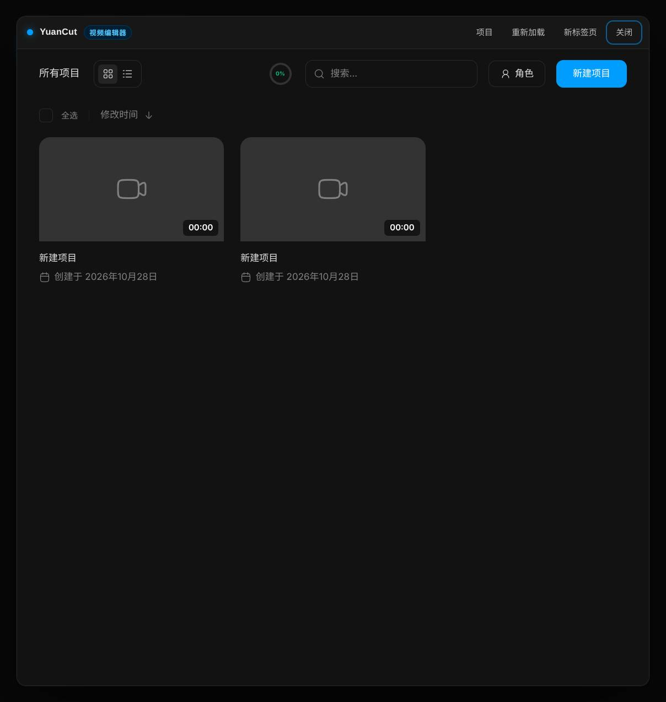

# ComfyUI-YuanCut

在 ComfyUI 里直接使用 YuanCut 视频编辑器：一个纯前端、本地优先的剪辑器，
界面由打包进插件的静态前端提供，不需要 Node 进程、数据库或上传素材。

集成方式：**静态前端 + ComfyUI 自带 aiohttp 托管 + 节点/顶栏入口 + iframe 弹层**。

- 打开即进入 **所有项目**，点项目才进入编辑器
- 素材与项目都存在浏览器 IndexedDB（与 ComfyUI 同源），不上传
- 一个 `YuanCut` 节点 + 顶栏 `YuanCut` 按钮，双击节点或右键菜单也能打开
- 关闭弹层后 iframe 常驻内存，再次打开秒开，编辑状态不丢
- 界面固定中文（内置编辑器直接以 zh 打开，插件按钮/提示/说明均为中文）



## 安装

```bash
cd ComfyUI/custom_nodes
git clone <this-repo> ComfyUI-YuanCut      # 或者直接把目录复制/软链进来
```

重启 ComfyUI，刷新前端页面即可。`yuancut-ui/` 已随仓库提供，开箱即用。

## 使用

三种入口，效果相同：

1. 新建节点 → 分类 **YuanCut** → **YuanCut 视频编辑器**，点节点里的「打开 YuanCut」
2. 双击该节点，或右键节点 →「打开 YuanCut 编辑器」
3. ComfyUI 顶栏的 **YuanCut** 按钮

打开后直接落在 **所有项目**，点某个项目才进入编辑器。
弹层右上角还有：**项目**（回到项目列表）、**重新加载**（重载当前页）、**新标签页**、**关闭**。
也可以直接访问 `http://<comfyui>:8188/yuancut/`（自动落到项目列表）或 `/yuancut/zh/editor/`。

## 目录结构

```
ComfyUI-YuanCut/
├── __init__.py             # /yuancut 静态路由 + WEB_DIRECTORY
├── nodes.py                # YuanCut 节点（OUTPUT_NODE，不参与采样）
├── js/
│   └── yuancut-launcher.js  # 节点 UI、顶栏按钮、iframe 弹层
├── yuancut-ui/              # 前端静态导出（Next.js output: export）
├── tools/
│   ├── build_ui.sh          # 从源码重建 yuancut-ui/
│   └── patch_webapp.py      # 静态化 + /yuancut basePath + 品牌替换补丁
├── pyproject.toml
└── requirements.txt
```

## 重建 yuancut-ui/

`yuancut-ui/` 是前端 `apps/web` 的静态导出产物。升级上游源码后重新生成：

```bash
tools/build_ui.sh /path/to/webapp-source
```

脚本会：复制源码到临时目录（**不会改动你的仓库**）→ 应用 `tools/patch_webapp.py`
→ `pnpm install` → `next build`（`output: "export"`）→ 把 `out/` 同步到 `yuancut-ui/`。
需要 `pnpm`、`python3`、`rsync`，首次安装依赖约 1.3 GB。

### 静态化都改了什么

| 改动 | 原因 |
| --- | --- |
| `output: "export"` + `basePath: "/yuancut"` + `trailingSlash` | 交给 ComfyUI 托管，资源不与 `/_next` 冲突 |
| 编辑器路由从 `/editor/<uuid>` 改为 `/editor?project=<uuid>` | 静态导出无法预渲染任意 uuid 的动态路由 |
| 删除 `src/app/api/**`、`middleware.ts` | 静态站点没有服务端 |
| 删除 `lib/auth`、`lib/db`、`lib/r2`、`lib/rate-limit` | 只被已删除的 API 使用，且与新版依赖类型不兼容 |
| 移除 `botid` 与统计脚本 | 纯本地插件不引外链 |
| 公开资源改用 `withBasePath()`，logo 目录改为 `logos/yuancut` | 资源要走 `/yuancut` 前缀 |
| `next/image` 关闭优化 | 静态导出没有图片优化服务 |
| 删除首页与营销页（`/[locale]/page.tsx`、privacy、terms、roadmap、why-not-capcut、playground）及其 `landing`/`header`/`footer` 组件、`public/preview` 素材 | 入口直接是「所有项目」，静态包里不再需要官网页面 |
| 构建后清理 `locales/`、`preview/`，图标只保留 manifest 引用的 192/512，删除未引用的历史图标与 `logos/others` | 运行时不会请求这些文件，纯减体积 |
| 品牌词与 manifest/locales/页面标题统一替换为 **YuanCut** | 插件内不再出现旧名字 |

## 已知限制

静态版只保留**编辑器本身**。依赖服务端的入口在构建时已处理：

- Freesound 音效搜索（`/api/sounds/*`）的标签页已隐藏
- AI 代理 / 文生图 / 文生视频（`/api/ai/*`）、参考图上传（`/api/upload/*`）、
  文本转语音（`/api/tts/*`）、反馈（`/api/feedback`）、账号登录：按钮仍在，
  但请求会 404，需要服务端才能用
- 官网页面（首页、隐私、条款、路线图、why-not-capcut、playground）已从构建中移除，
  只保留编辑器、项目列表和角色页

时间线、预览、字幕、素材导入、本地导出（FFmpeg.wasm / mediabunny）等纯前端能力不受影响。
项目保存在浏览器 IndexedDB：换浏览器或清站点数据会看不到旧项目。

## 轨道结构

新项目默认三条轨道（上 → 下）：

1. **文字 / 特效**：只能放文字（贴纸等叠加轨道同属这一层）
2. **主视频**（主轨）：只能放视频/图片与转场，位置固定
3. **音频**：只能放音频与音效

追加与排序规则（每次写入都会统一整理，不会穿插）：

- 新视频轨道 → 主视频轨道正上方（副视频轨道紧贴主轨，文字轨道仍在最上层）
- 新文字 / 贴纸轨道 → 最上层
- 新音频轨道 → 最下层
- 三条基础轨道（文字、主视频、音频）**不可删除**，删到只剩一条也不会发生
- 旧项目打开时会自动补齐缺失的基础轨道（例如只有主轨的项目会补上文字轨与音频轨）

## 音频导出 / 合并

- 选中音频片段后 **右键 →「导出音频」**：导出为 WAV
  - 单段：直接导出，不加编号
  - 多段：按时间轴从左到右分别导出，文件名自动编号 `01_…`、`02_…`
- 选中多段音频后 **右键 →「合并选中的音频」**：合并成一段整体音频
  - 只支持同一条音频轨道上的片段；保留相对位置与中间的空隙
  - 合并结果是新的音频素材（`合并音频`），之后导出就是一个完整文件
- 音频同样可以用「拆分」剪开，再合并回去

## 时间轴刻度

- 默认缩放开在 **5 秒一格**（30 px/秒，标签间距 150 px），格内保留 1 秒细刻度
- 放大 / 缩小会按像素间距自动切换刻度：帧级 → 1 秒 → 3 秒 → 5 秒 → 10 秒 → 30 秒…
- 空时间轴或很短的工程也能缩到约 30 秒的可视范围（原来会被“适应宽度”卡在过细的刻度上）

## 图标

同一张图只保留两种格式，各有不可替代的用途：

- `assets/logo.svg` → 界面 logo、`<link rel="icon">`、OG 图（矢量，任意尺寸清晰）
- `assets/favicon.ico` → 一个文件内含 16/32/48/64，供老式标签页/书签兜底

构建时只复制这两份到前端，`manifest.json` 也只引用 SVG；不再生成 `/icon.svg` 副本和 android/apple/ms 等 PNG 尺寸。

## 语音转字幕

字幕转录只有一个方法：**本机 MOSS-Transcribe-Diarize 模型**（原来的 Whisper
Small / Large v3 Turbo / Distil Small 三个浏览器模型已全部删除）。

- 前端只做音频准备：把片段解码成 16 kHz 单声道 Float32，每 5 分钟一块 POST 到
  `/yuancut/transcribe`，再把返回的句段画成字幕
- 后端（`yuancut_transcribe.py`）在本机调用 MOSS 推理，一次拿到「说话人 + 起止时间 + 文本」，
  不需要浏览器下载权重，也不依赖 WebGPU/WASM
- 权重放在 **`ComfyUI/models/Yuan_Cut/MOSS-Transcribe-Diarize/`**（约 1.8 GB）；
  节点包 `custom_nodes/ComfyUI-Moss-Diarize-Yuan/models/MOSS-Transcribe-Diarize`
  现在是指向该目录的软链接，MOSS 节点和字幕转录共用同一份权重
- 引擎来自 `custom_nodes` 下的 MOSS 节点包（`moss_engine.py`），只借用它的推理代码，
  不注册任何 ComfyUI 节点；找不到 Yuan_Cut 权重时回退到节点包自带目录
- `GET /yuancut/transcribe` 返回引擎状态（是否找到模型包、权重是否就绪），便于排查
- 模型首次转写时载入并常驻显存（BF16 + SDPA），之后重复转写不再重新加载
- 单次请求上限 5 分钟音频，长素材由前端自动分块并拼接时间轴；后端最多接受 1 小时
- 改了 `yuancut_transcribe.py` 或新增路由后需要重启 ComfyUI；只换前端静态文件不用重启

## 音频标签（音效 / 提取音频）

左侧面板在「媒体」和「文字」之间多了一个 **音频** 标签，样式与「媒体」一致
（同一套卡片网格、图标按钮、拖拽与滚动条），离线可用，不需要任何服务端接口：
- 卡片和「媒体」面板是**同一套组件**：直接复用 `media.tsx` 里的 `GridView` + `MediaPreview`
  （同一份缩略图/占位图、时长角标、右键菜单、拖拽与选中样式），音频面板不再各写一套
- **添加音频 / 音效**：左上角音乐图标按钮，选本地音频文件（`audio/*`），
  走与「媒体」相同的导入管线，导入后以同样的卡片出现在音频面板
- **从视频提取音频**：左上角摄影机图标按钮，选本地视频文件（`video/*`），
  用 mediabunny 抽出音轨，转成 `原名.wav` 存进音频面板（不转码整个视频，只取音频轨）
- **播放与媒体一致**：点卡片 = 选中，右侧**播放框**用同一个播放器播放，带原生进度条；
  再点一次取消选中。拖动进度条、暂停/继续都在播放框里完成
- 面板也支持把音频/视频直接拖进来：音频按普通素材导入，视频自动走提取流程
- 卡片可以拖到时间轴，也可点「＋」按播放头插入；拖拽素材到时间轴时与「媒体」行为一致
- 全部在浏览器本地完成，文件不上传；提取失败会逐个文件提示，不影响其它文件

### 媒体与音频是两套独立的素材库

- 素材带一个归属标记（`panel`）：`media` 属于媒体面板，`audio` 属于音频面板
- **媒体面板只显示 media**：即使往媒体里拖音频，它也只留在媒体里，不会出现在音频面板
- **音频面板只显示 audio**：音频面板导入或提取的素材，也不会跑到媒体面板
- 归属标记随素材一起存进 IndexedDB/OPFS，刷新或重开项目都保持分开
- 本次升级前已存在的素材没有归属标记，按 `media` 处理（会显示在媒体面板）；
  需要出现在音频面板的旧音频，重新导入一次即可

## 素材框选与删除

- 「媒体」和「音频」面板都支持**框选**：在空白处按住左键拖出选框，与选框相交的素材会被选中，
  卡片显示选中描边；面板**右下角**显示「已选 N 项」
- **只有一套右键菜单**（面板级），右键任意位置弹的都是它，菜单内容：删除 / 导出所选 / 取消选择；
  三者都作用于**当前选中集合**，与右键点在哪张素材上无关
- 右键一个还没被选中的素材时，会先把它并入选中；已经在选中集合里（框选多条）就保持整个多选不动
- **左键选中也会进选中集合**：点一张卡片等于单选它，此时右键菜单的「删除 / 导出所选」和
  键盘 **Delete / Backspace** 都直接作用于这一条；再点一次卡片取消选中
- 选中后按键盘 **Delete / Backspace** 删除（监听在捕获阶段，不会被时间轴的快捷键吞掉）
- 实现上，动作发生时直接读选中集合（`getState()`），不再用渲染时的快照，
  所以框选后立刻右键也一定是删全部
- 面板上不再有常驻的操作栏/按钮，选中数量只在右下角的小角标里显示
- 点击空白处或切到别的标签页会清空选中，不会残留在别的面板
- **删除素材不会破坏时间线**：时间轴上的片段保留原位置、时长和轨道，
  只是标红显示「素材丢失」，方便你重新导入同名素材或自行调整
- 素材丢失时的表现：预览不再渲染该片段（不会黑屏或报错），音频播放自动跳过该段，
  导出的成片同样保持时间线节奏不变

## 性能说明（进入 / 退出项目）

- **预取**：插件返回项目列表 HTML 时注入 `<link rel="prefetch">`，把编辑器要用的
  JS/CSS（约 3 MB）提前拉进浏览器缓存，第一次进入项目也不用现下载
- **不整页重载**：弹层顶栏的「项目」改为 `postMessage` + 前端路由跳转
  （前端 `components/providers/host-bridge.tsx`），不再重载整个 iframe
- **素材并发**：项目素材从 IndexedDB 读取改为 4 路并发（原来是逐个串行），
  素材多的项目进入明显更快
- **加载提示**：首次打开或「重新加载」时显示「正在加载 YuanCut…」，
  延迟 150 ms 出现，避免快速加载时闪烁
- **退出项目不再等缩略图**：视频项目直接跳过（改在下次进入时后台生成），
  其它项目最多等 200 ms；空项目（时长 0）立即返回

本地实测（缓存命中、localhost）：打开面板 ≈40 ms、进入项目 ≈40 ms、
站内「项目」跳转 ≈30 ms、退出项目 ≈50–80 ms，无长任务（long task）。
首次冷启动受机器磁盘/ComfyUI 自身负载影响，会看到加载提示。

## 许可

插件代码：MIT。内置前端来自一个 MIT 许可的开源视频编辑器，原始版权与许可声明
保留在 [LICENSE](LICENSE)，分发时请一并保留。
